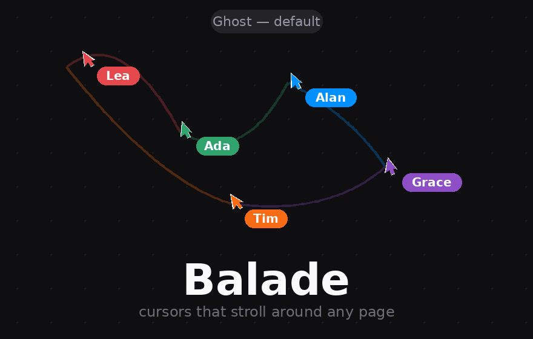
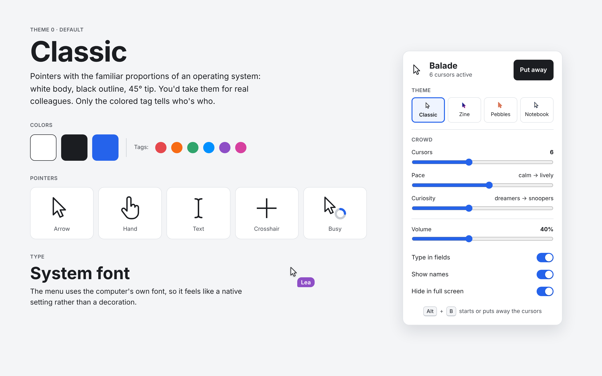
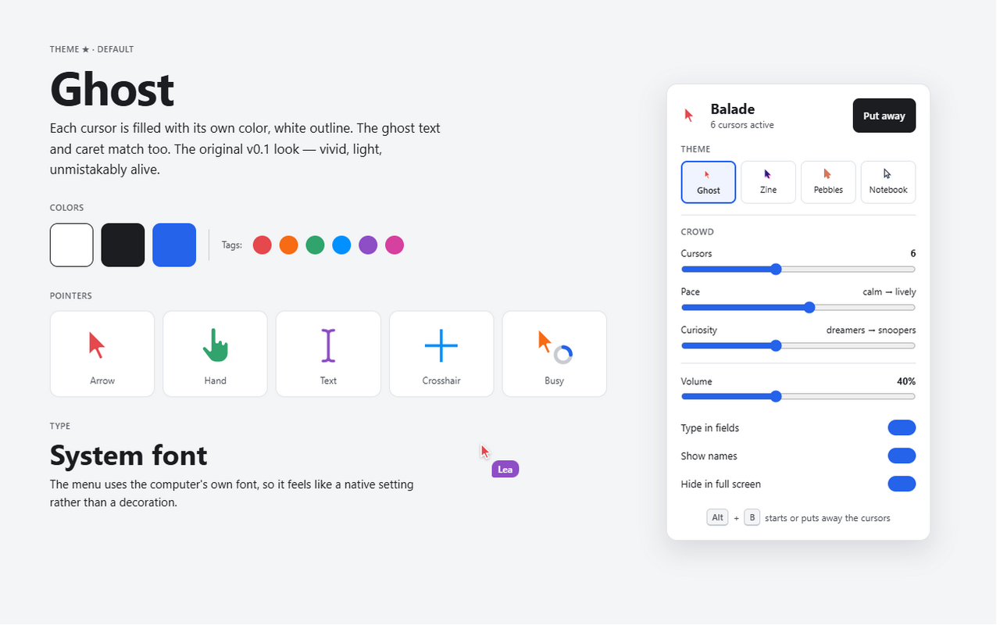
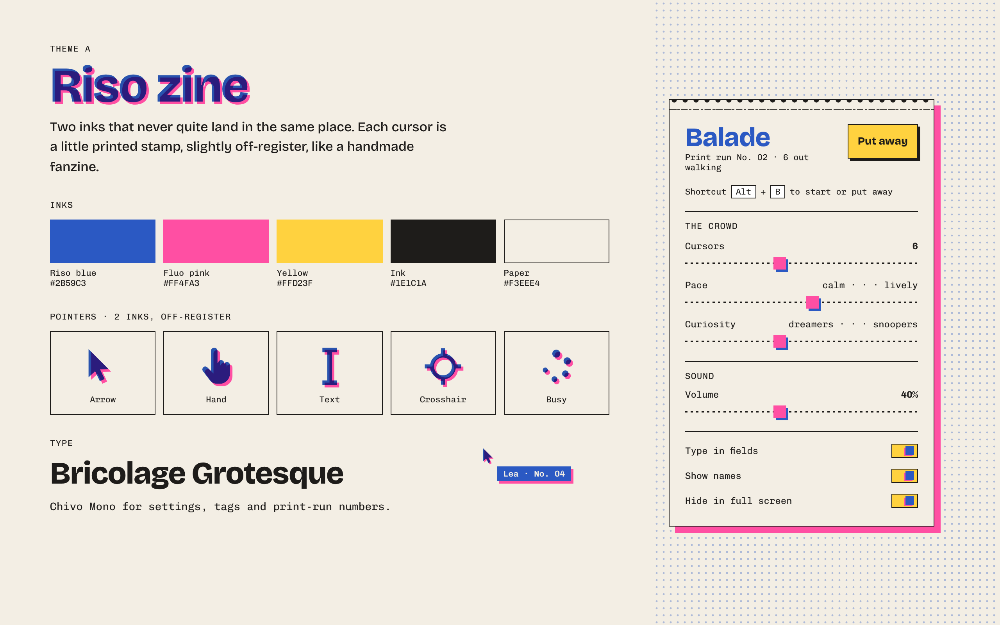
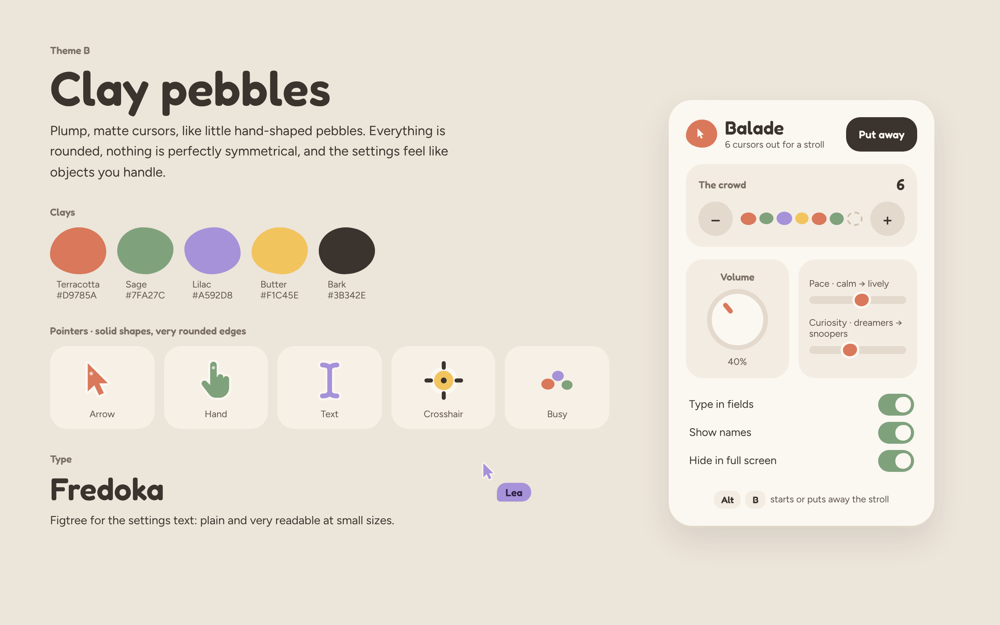
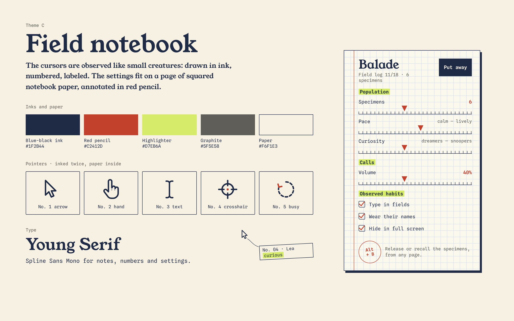

# Balade

*Français : [README.fr.md](README.fr.md)*

Cursors that stroll around any web page, like a team of colleagues working alongside you.
Plain JavaScript, object-oriented, no bundler, no dependencies.

## Install

`chrome://extensions` → turn on Developer mode → "Load unpacked" → pick this folder.

- **Alt+B** starts or puts away the cursors on the current tab (change it in `chrome://extensions/shortcuts`).
- **Click the icon** to open the menu: Start/Put away button, theme and settings.
  Settings are saved (`chrome.storage.sync`) and apply live on the page.
- **Esc** sends the cursors back to wandering.

Sounds start after your first click or key press on the page (a browser rule).
The extension can't run on Chrome's protected pages (`chrome://`, Chrome Web Store).

> The extension's interface (menu, options, speech bubbles) is currently in French.

## Try it without installing

`demo.html` loads the same scripts and shows the menu next to the page. For the menu to drive
the page, serve the folder locally (for example `python3 -m http.server`) and open
`http://localhost:8000/demo.html`. Opened directly as a file, the cursors work but the menu
is decorative.

## Themes

| Theme | Spirit |
| --- | --- |
| **Ghost** (default) | cursor filled with its own color, white outline — the original v0.1 look |
| Classic | pointers with the proportions of an operating system: white body, black outline |
| Riso zine | two risograph inks, slightly off-register |
| Clay pebbles | plump, matte shapes in clay colors |
| Field notebook | inked lines, numbered specimens, red pencil |

| | | |
| --- | --- | --- |
|  |  |  |
|  |  | |

Each theme draws five pointers (arrow, hand, text, crosshair, busy), all in SVG.
The pointer changes like in a real browser: a hand over links and buttons, an I-beam over
fields, a crosshair over images, busy during some pauses.

## How they move

- **Curved paths**: chained circular arcs rather than straight lines.
- **Human timing**: duration from Fitts's law, a minimum-jerk speed profile, an aim followed by a small correction, then a click that presses down.
- **Moods**: each cursor has a temperament (calm, curious, busy…) and alternates strolling, fidgeting and inspecting the page.
- **Jostling**: your mouse pushes the cursors away; a damped spring brings them back.
- **Typing**: curious cursors type ghost text into empty fields (drawn on top, the field's value never changes).
- **Sounds**: one voice per cursor, in a pentatonic scale, panned to where the cursor is.

## Anticipation and habits

- **Guess my moves**: from the direction and braking of your mouse, a cursor heads for the element you're aiming at, often before you get there.
- **Learn my habits**: Balade remembers your click sequences on each site and waits for you on the next step when it is predictable enough.

Everything stays on this computer; only the identity of clicked elements is stored, never what
you type. The menu shows what has been learned on the site and lets you forget it.
Consider excluding sensitive sites ("This site" section).

## Per-site settings

In the menu, the "This site" section lets you never run Balade on a site (useful for internal
tools or pages showing sensitive data), or start it there automatically. Auto-start asks for
access to that site, and that site only.

## Dark pages

Each cursor looks at the background under it and adapts its pointer when it is dark
("Adapt to dark pages" switch).

## Social life and reactions

- **Shared attention**: keep your mouse still for about a second, or type in a field, and the curious ones come to look; they leave when you move away.
- **Encounters**: a wave, a little sound, sometimes one follows the other.
- **Reactions**: a rush toward your clicks, a cheer when you submit a form.
- **Swarm on demand**: press Shift, then hold Shift.

Two menu switches control these: "Chat with each other" and "React to what I do".

## Games and tools

From the menu:
- **Play tag**: catch the cursors with your mouse (Esc to stop).
- **Focus · 25 min**: the cursors leave, then come back for the break.
- **Record a video of the tab**: a WebM file downloaded when you stop (2 minutes max).

## Customization

"Customize…" link at the bottom of the menu (or right-click the icon → Options): your own
names, a custom theme (starting style, colors, imported SVG pointer, sanitized), with a preview.

## Scrolling

The cursors live on the page, not on the screen. When you scroll, they move with the content,
then each one catches up after a reaction time (0.3 to 1.5 s depending on its patience;
sometimes longer if it is "busy"). A cursor out of view shows up as a marker with its name at
the top or bottom of the screen.

## Project layout

Every file declares its classes on `window.Balade`. With no bundler, they are injected in the
order of `FILES` (`lib/inject.js`), which is also the order of the `<script>` tags in `demo.html`.

| File | Role |
| --- | --- |
| `background.js` | Alt+B shortcut, auto-start, recording messages |
| `lib/inject.js` | script injection, start/put away, tab state |
| `popup/` | the menu (HTML, CSS with the four styles, JS) |
| `options/` | the customization page |
| `offscreen/` | video recording (offscreen document) |
| `core/SvgSanitizer.js` | sanitizes imported SVG pointers |
| `core/Config.js` | internal motion settings |
| `core/Settings.js` | user settings: storage and mapping to parameters |
| `entities/Cursor.js` | position, page view, temperament, micro-signals |
| `motion/Path.js` | chained circular-arc paths |
| `motion/Motion.js` | gestures: Fitts's law, minimum jerk, aim + correction, click |
| `world/Stage.js` | screen, page elements, where to aim, background, full screen |
| `world/Predictor.js` | gesture anticipation |
| `world/Habits.js` | learning click sequences (local) |
| `behaviors/*.js` | arrive, leave, wander, attention (`Gather`), follow (`Follow`), swarm (`Swarm`), anticipate (`Anticipate`), flee (`Flee`) |
| `render/Themes.js` | the four themes and their pointers |
| `render/FontLoader.js` | fonts bundled for the overlay |
| `render/Renderer.js` | Shadow DOM overlay, name tags, edge markers, ghost text |
| `audio/Sound.js` | small synthesized sounds (Web Audio) |
| `engine/Engine.js` | loop, population, scrolling, mouse, full screen |
| `main.js` | `Balade.toggle()` and settings tracking |
| `autostart.js` | auto-start on chosen sites |

## Adding a behavior

1. Create `src/behaviors/MyBehavior.js`: a class that extends `Behavior` and implements `*run(cursor)`.
2. Add it to `FILES` (`lib/inject.js`) and to the `<script>` tags in `demo.html`, before `Engine.js`.
3. Pick it in `Engine.chooseBehavior(cursor)`.

## What is never touched

Clicks are simulated (the cursor presses down, a sound plays); no event is sent to the page.
Ghost text is drawn on top of the field: the field's value never changes.
Password, disabled, read-only, already filled or in-use fields are skipped.

## Going further

Interactive explainer with live animated demos: [docs/how-it-works.html](docs/how-it-works.html).

The principles and formulas studied before writing Balade: [docs/research.en.md](docs/research.en.md).

## Fonts

Bricolage Grotesque, Chivo Mono, Fredoka, Figtree, Young Serif and Spline Sans Mono, under the
SIL Open Font License 1.1 (see `fonts/licences/`).
